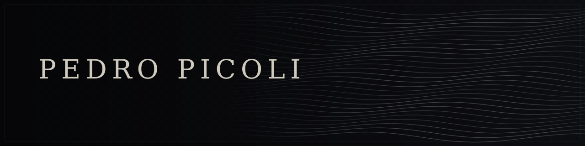

  
    <b>English</b> &nbsp;·&nbsp; <a href="README_PT.md">Português</a>
  

  

  <samp>— ·  · —</samp> 
  <b><i>Building Realities</i></b> 
  <samp>— ·  · —</samp>

 

## ◆ Pedro Picoli

>*"I hold the conviction that only by understanding varied portions do we understand the whole, and by understanding the whole, we create new portions and become part of a new whole."*

I navigate between software, natural language model engineering, product, research, and literature. The majority of my repositories are private, as I consider virtually everything a continuous *work in progress*, making publicly available only scarce projects requested by friends or that may provide immediate support to the community.

 

 

## ◆ Areas of Expertise

<table>
<tr>
<td width="50%" valign="top">

#### ✦ Engineering & Product
`Architecture` · `Full-Stack` · `Scalability`

</td>
<td width="50%" valign="top">

#### ✦ Applied AI & Language Models
`LLMs` · `Prompt Engineering` · `Automation`

</td>
</tr>
<tr>
<td width="50%" valign="top">

#### ✦ Writing & Research
`Literature` · `Scientific Papers` · `Storytelling`

</td>
<td width="50%" valign="top">

#### ✦ Data & Strategic Communication
`Data Journalism` · `Technical SEO` · `UX & Neuromarketing`

</td>
</tr>
</table>

 

## ◆ Research Areas & Interests

<table>
<tr>
<td width="50%" valign="top">

#### ◈ AI, Computer Vision & Cyber-Physical Systems
`Tracking` · `Smart Surveillance` · `Digital Twins`

- **Computer Vision & Tracking**: Visual motion tracking, biomechanical analysis, and facial/body micro-expressions applied to human-machine interfaces.
- **Intelligent Surveillance & Assistance**: Data-driven monitoring systems, contextual automation, and assistive agents for everyday life.
- **Digital Twins**: Simulation, real-time data mirroring, and complex dynamic systems modeling.

</td>
<td width="50%" valign="top">

#### ◈ Digital Anatomy & Biotechnology
`Morphology` · `Biomechanics` · `Neural Interfaces`

- **Morphological Modeling**: Visual reconstruction, biomechanical analysis, and three-dimensional parameterization of the human body (with visual and functional focus on the brain interface).
- **Data-Driven Biotechnology**: Intersections between biological signals, neural systems, and computational processing of biomedical data.

</td>
</tr>
<tr>
<td width="50%" valign="top">

#### ◈ Cryptography & Systems Security
`Cryptanalysis` · `Post-Quantum` · `Resilience`

- **Information Security**: Cryptanalysis, post-quantum algorithms, and symmetric and asymmetric encryption protocols.
- **Architecture Resilience**: Data integrity, distributed privacy, and vulnerability auditing in critical systems.

</td>
<td width="50%" valign="top">

#### ◈ Theoretical Foundations of Mathematics & Physics
`Linear Algebra` · `Quantum Mechanics` · `Topology`

- **Applied & Abstract Mathematics**: Computational linear algebra, multivariable calculus, probability, and data topology.
- **Fundamental Physics**: Quantum mechanics, string theory, multiverses, and the physical limits of theoretical computing.

</td>
</tr>
</table>

 

## ◆ Journey

- **`2014`** &nbsp; ─── &nbsp; ◈ **Inception to Programming Logic**
  > First contact with code: algorithmic logic, scripts, and experimentation with modifying digital behaviors.

- **`2017`** &nbsp; ─── &nbsp; ◈ **Interactive Systems & Automation**
  > Development of extensions, integrations, and automation routines aimed at applications and games.

- **`2019`** &nbsp; ─── &nbsp; ◈ **First Commercial Product**
  > Conception and launch of proprietary optimization software sold under a subscription model (SaaS).

- **`2020`** &nbsp; ─── &nbsp; ◈ **Narrative & Digital Strategy**
  > Content production, technical scriptwriting, and specialized copywriting for YouTube channels (aviation).

- **`2022`** &nbsp; ─── &nbsp; ◈ **Software Engineering & Applied AI**
  > Full-stack software engineering, digital consulting, and integration of advanced artificial intelligence models.

- **`2026`** &nbsp; ─── &nbsp; ◈ **Recognitions & Future**
  > Hackavitru (Top 3% nationally) · Academic Paper at Intercom Júnior (Brasília/DF) · Completion of the Journalism cycle · Drafts of future AI models for various applications.

 

## ◆ Featured

<table>
  <tr>
    <td width="100%">
      <h3>◈ <a href="https://github.com/PedroPicoli/NeoNuvio">NeoNuvio</a></h3>
      

        
        
        
        
      

      

        Entertainment hub enhanced and maintained by me, designed with a focus on user experience fluidity, rapid implementation of community-requested features, and continuous exploration of new technologies.
      

    </td>
  </tr>
</table>

 

## ◆ Honors & Publications

<table>
  <tr>
    <td width="33%" valign="top">
      <h4>🏆 Hackavitru 2026</h4>
        
      Selected among the 32 qualifiers out of nearly 1,000 applicants nationwide for the first national hackathon by Vitru Educação (São Paulo/SP).
    </td>
    <td width="33%" valign="top">
      <h4>📜 Intercom Júnior 2026</h4>
        
      Scientific research paper presented in person in Brasília/DF at the 49th Brazilian Congress of Communication Sciences and published in the official proceedings.
    </td>
    <td width="33%" valign="top">
      <h4>🌐 ClimateScience Olympiad 2023</h4>
        
      Ranked as a semifinalist in the premier international olympiad on climate solutions and scientific reasoning.
    </td>
  </tr>
  <tr>
    <td width="33%" valign="top">
      <h4>✍️ Author</h4>
        
      Physically published fiction short stories, haikus, tankas, and poems.
    </td>
    <td width="33%" valign="top">
      <h4>📝 Writing</h4>
        
      Participation in the literary contests Pena de Ouro and Microconto de Ouro (2022).
    </td>
    <td width="33%" valign="top"></td>
  </tr>  
</table>

 

## ◆ Stack & Tools

<!-- Engenharia & Desenvolvimento -->

 

<!-- IA & Modelos de Linguagem -->

 

<!-- Escrita, Pesquisa & Publicação -->

 

<!-- Design, Criatividade & Ferramentas -->

 

## ◆ Languages

 

Porto Alegre, RS · Brazil

