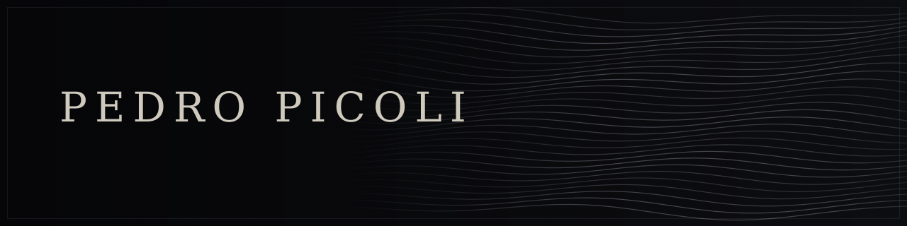

  
    <a href="README.md">English</a> &nbsp;·&nbsp; <b>Português</b>
  

  

  <samp>— ·  · —</samp> 
  <b><i>Construindo Realidades</i></b> 
  <samp>— ·  · —</samp>

 

## ◆ Pedro Picoli

>*"Tenho convicção de que somente compreendendo variadas porções, é que compreendemos o todo e, compreendendo o todo, que criamos novas porções e passamos a fazer parte de um novo todo."*

Transito entre software, engenharia de modelos de linguagem natural, produto, pesquisa e literatura. A maioria dos meus repositórios é privada, pois considero praticamente tudo um contínuo *work in progress*, disponibilizando publicamente apenas escassos projetos solicitados por amigos ou que possam causar um imediato apoio à comunidade.

 

 

## ◆ Áreas de Atuação

<table>
<tr>
<td width="50%" valign="top">

#### ✦ Engenharia & Produto
`Arquitetura` · `Full-Stack` · `Escalabilidade`

</td>
<td width="50%" valign="top">

#### ✦ IA Aplicada & Modelos de Linguagem
`LLMs` · `Prompt Engineering` · `Automação`

</td>
</tr>
<tr>
<td width="50%" valign="top">

#### ✦ Escrita & Pesquisa
`Literatura` · `Artigos Científicos` · `Storytelling`

</td>
<td width="50%" valign="top">

#### ✦ Dados & Comunicação Estratégica
`Jornalismo de Dados` · `SEO Técnico` · `UX & Neuromarketing`

</td>
</tr>
</table>

 

## ◆ Áreas de Pesquisa & Interesses

<table>
<tr>
<td width="50%" valign="top">

#### ◈ IA, Visão Computacional & Sistemas Ciberfísicos
`Tracking` · `Smart Surveillance` · `Digital Twins`

- **Visão Computacional & Tracking**: Rastreamento visual de movimento, análise biomecânica e microexpressões faciais/corporais aplicadas à interface humano-máquina.
- **Vigilância Inteligente & Assistência**: Sistemas de monitoramento orientados por dados, automação contextual e agentes de assistência para o cotidiano.
- **Gêmeos Digitais**: Simulação, espelhamento de dados em tempo real e modelagem de sistemas dinâmicos complexos.

</td>
<td width="50%" valign="top">

#### ◈ Anatomia Digital & Biotecnologia
`Morphology` · `Biomechanics` · `Neural Interfaces`

- **Modelagem Morfológica**: Reconstrução visual, análise biomecânica e parametrização tridimensional do corpo humano (com foco visual e funcional da interface cerebral).
- **Biotecnologia Orientada a Dados**: Intersecções entre sinais biológicos, sistemas neurais e processamento computacional de dados biomédicos.

</td>
</tr>
<tr>
<td width="50%" valign="top">

#### ◈ Criptografia & Segurança de Sistemas
`Cryptanalysis` · `Post-Quantum` · `Resilience`

- **Segurança da Informação**: Criptoanálise, algoritmos pós-quânticos e protocolos de cifragem simétrica e assimétrica.
- **Resiliência de Arquiteturas**: Integridade de dados, privacidade distribuída e auditoria de vulnerabilidades em sistemas críticos.

</td>
<td width="50%" valign="top">

#### ◈ Fundamentos Teóricos de Matemática & Física
`Linear Algebra` · `Quantum Mechanics` · `Topology`

- **Matemática Aplicada & Abstrata**: Álgebra linear computacional, cálculo multivariado, probabilidade e topologia de dados.
- **Física Fundamental**: Mecânica quântica, teoria das cordas, multiversos e os limites físicos da computação teórica.

</td>
</tr>
</table>

## ◆ Em Destaque

<table>
  <tr>
    <td width="100%">
      <h3>◈ <a href="https://github.com/PedroPicoli/NeoNuvio">NeoNuvio</a></h3>
      

        
        
        
        
      

      

        Hub de entretenimento aprimorado e mantido por mim, projetado com foco em fluidez de experiência do usuário, implementação rápida de recursos solicitados pela comunidade e contínua exploração de novas tecnologias.
      

    </td>
  </tr>
</table>

 

## ◆ Conquistas & Publicações

<table>
  <tr>
    <td width="33%" valign="top">
      <h4>🏆 Hackavitru 2026</h4>
        
      Selecionado entre os 32 aprovados dentre quase 1.000 inscritos em todo o país para o primeiro hackathon nacional da Vitru Educação (São Paulo/SP).
    </td>
    <td width="33%" valign="top">
      <h4>📜 Intercom Júnior 2026</h4>
        
      Trabalho de pesquisa científica apresentado presencialmente em Brasília/DF no 49º Congresso Brasileiro de Ciências da Comunicação e publicado nos anais oficiais.
    </td>
    <td width="33%" valign="top">
      <h4>🌐 ClimateScience Olympiad 2023</h4>
        
      Classificação como semifinalista na principal olimpíada internacional de soluções e raciocínio científico sobre mudanças climáticas.
    </td>
  </tr>
  <tr>
    <td width="33%" valign="top">
      <h4>✍️ Autor</h4>
        
      Publicados fisicamente contos de ficção, haicais, tankas e poemas.
    </td>
    <td width="33%" valign="top">
      <h4>📝 Escrita</h4>
        
      Participação nos concursos literários Pena de Ouro e Microconto de Ouro (2022).
    </td>
    <td width="33%" valign="top"></td>
  </tr>  
</table>

 

## ◆ Stack & Ferramentas

<!-- Engenharia & Desenvolvimento -->

 

<!-- IA & Modelos de Linguagem -->

 

<!-- Escrita, Pesquisa & Publicação -->

 

<!-- Design, Criatividade & Ferramentas -->

 

## ◆ Idiomas

 

Porto Alegre, RS · Brasil

